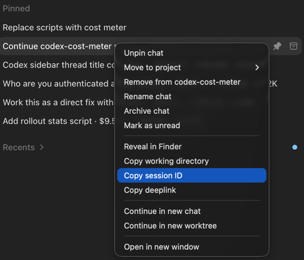
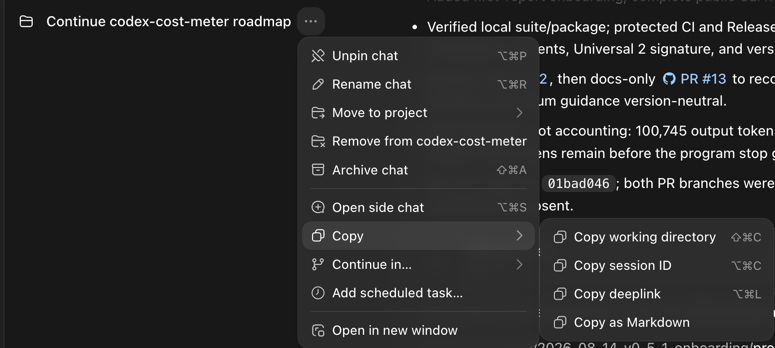

# User guide

## Install and run

### Homebrew on macOS

Homebrew is the recommended macOS path. The custom tap builds the pinned release source with its committed `Cargo.lock` and links the command onto `PATH`:

```text
brew tap deinspanjer/codex-cost-meter https://github.com/deinspanjer/codex-cost-meter
brew install deinspanjer/codex-cost-meter/codex-cost-meter
codex-cost-meter report <THREAD_ID>
```

On macOS, Homebrew-installed schedules use Homebrew's stable `opt` executable path and survive upgrades. To uninstall, use `codex-cost-meter schedule remove` followed by `brew uninstall codex-cost-meter`. Do not run the utility's self-uninstall on a Homebrew-owned executable.

Bash and Zsh completions are installed by Homebrew; run `codex-cost-meter completions --help` for setup details and manual installation.

### Cargo source install

With Rust 1.97.1 or newer installed, macOS, Windows, and Linux can build a pinned release directly from its tag:

```text
cargo install --locked --git https://github.com/deinspanjer/codex-cost-meter --tag v<VERSION> codex-cost-meter
```

Replace `<VERSION>` with the latest stable version. Cargo installs to its configured binary directory, normally `$CARGO_HOME/bin` or `~/.cargo/bin` on macOS and Linux and `%USERPROFILE%\.cargo\bin` on Windows. A local source build avoids the browser-download path, but it does not establish an Apple or Microsoft publisher identity or override organizational application-control policy. Remove a schedule before running `cargo uninstall codex-cost-meter`.

### Direct release archives

Use a direct archive when installing Homebrew or a Rust toolchain is not worthwhile:

1. Open the [latest stable release](https://github.com/deinspanjer/codex-cost-meter/releases/latest). Download the macOS Universal 2 `.tar.gz` archive, Windows x64 `.zip` archive, Linux x86_64 musl `.tar.gz` archive, or Linux aarch64 musl `.tar.gz` archive, plus that archive's matching `.sha256` file.
2. Verify the download before extracting it. On macOS, run `shasum -a 256 -c codex-cost-meter-v<VERSION>-macos-universal2.tar.gz.sha256`. On Linux, run `sha256sum -c codex-cost-meter-v<VERSION>-linux-x86_64-musl.tar.gz.sha256` or `sha256sum -c codex-cost-meter-v<VERSION>-linux-aarch64-musl.tar.gz.sha256`. In PowerShell on Windows, run `& { $archive = 'codex-cost-meter-v<VERSION>-windows-x64.zip'; $expected = (Get-Content "$archive.sha256" -Raw).Trim().Split()[0]; if ((Get-FileHash $archive -Algorithm SHA256).Hash -ne $expected) { throw "checksum mismatch" } }`.
3. Extract the verified archive: `tar -xzf codex-cost-meter-v<VERSION>-macos-universal2.tar.gz` on macOS, `tar -xzf codex-cost-meter-v<VERSION>-linux-x86_64-musl.tar.gz` or `tar -xzf codex-cost-meter-v<VERSION>-linux-aarch64-musl.tar.gz` on Linux, or `Expand-Archive codex-cost-meter-v<VERSION>-windows-x64.zip -DestinationPath .\codex-cost-meter` in PowerShell.
4. [Copy the session ID from the Codex app](#find-your-session-id), then run `./codex-cost-meter report <THREAD_ID>` on macOS or Linux, or `& .\codex-cost-meter\codex-cost-meter.exe report <THREAD_ID>` in PowerShell.

Place a directly downloaded binary in a directory you choose. If you have no preference, use `~/.codex/codex-cost-meter` on macOS or Linux, or `$env:USERPROFILE\.codex\codex-cost-meter.exe` in PowerShell on Windows. The Windows location is a suggestion, not a requirement.

The Windows ZIP contains `codex-cost-meter.exe`, `README.md`, and `LICENSE`.

macOS and Linux examples:

```text
~/.codex/codex-cost-meter report <THREAD_ID>
~/.codex/codex-cost-meter report <THREAD_ID> --json
~/.codex/codex-cost-meter report <THREAD_ID> --refresh
~/.codex/codex-cost-meter report <THREAD_ID> --codex-home <PATH>
```

Windows uses the same `report` and `update` arguments with `codex-cost-meter.exe`. In PowerShell, replace the placeholder before running:

```text
$threadId = "<THREAD_ID>"
& "$env:USERPROFILE\.codex\codex-cost-meter.exe" report $threadId
& "$env:USERPROFILE\.codex\codex-cost-meter.exe" update --thread-id $threadId
```

Use the bare executable name only when you place it in an existing directory on `PATH`; the tool does not require or create a `bin` directory under the Codex home. The tool resolves the Codex directory in this order: `--codex-home`, `CODEX_HOME`, then the platform home plus `.codex`. `report` never changes Codex task data. It may read Codex's SQLite projection to narrow discovery, with rollout-file fallback; `update` is dry-run by default and reads the supported local SQLite state for title-update selection or application (details below).

Reports read both plain `.jsonl` histories and Zstandard-compressed `.jsonl.zst` histories, including compressed descendants. Paginated histories are combined by session ID in page order; duplicate copies and identical page-overlap records count once. Usage counters and turn state continue across pages. No external decompression command is required.

The first successful analysis creates `codex-cost-meter.sqlite` in the selected Codex home and prints its path once. This app-owned, disposable cache stores rollout metadata and parsed usage facts; report pricing and aggregation remain live. An entry is reused only when the rollout file's modification time and size match. `report --refresh` and `update --refresh` reprocess only the selected roots and linked descendants.

If an existing cache can be read but not written, the command reuses compatible entries read-only, analyzes misses without storing them, and warns that it must be run with write permission to update the cache. If no cache exists, the command attempts to create one; a permission failure warns that write access is required and continues uncached. An unusable existing cache likewise produces one unavailable warning and continues without caching. To rebuild the cache manually, remove only `codex-cost-meter.sqlite` while no meter command is running; the next analysis recreates it. The cache is separate from Codex's `state_5.sqlite` and is not removed by schedule removal or uninstall.

The current release workflow produces a macOS archive containing a Developer ID-signed, hardened-runtime, timestamped, and notarized Universal 2 executable. Because a standalone executable cannot carry a stapled notarization ticket, Gatekeeper may need network access to retrieve its ticket from Apple on first execution. Older releases retain the signature state they had when published. The Windows executable remains unsigned, so Windows or organizational controls can require an explicit trust decision or block it. Verify the downloaded checksum and follow your organization's trust process; checksums and GitHub artifact attestations establish integrity or provenance independently of platform publisher identity. See [direct release trust and remaining unsigned paths](docs/unsigned-releases.md) for details.

## Find your session ID

The positional report selector and explicit `update --thread-id` commands accept a Codex session ID. If the root thread ID is not already in the Codex CLI status line, run `/status` to show it. To keep it visible between commands, run `/statusline` and add **Current thread identifier**. The app also offers two convenient ways to copy it:

1. Right-click the task in the sidebar and select **Copy session ID**.

   

2. Open the task header's ellipsis menu, select **Copy**, then select **Copy session ID**.

   

Paste that value in place of `<THREAD_ID>` or `<SESSION_ID>` in the examples. A session ID is often useful for support and reproducibility, but it can still identify a private task; review it before sharing.

You can also pass a thread deep link wherever a thread ID is accepted:

```text
codex-cost-meter report codex://threads/01a12843-3193-7a92-aba8-1f98c21c4284
codex-cost-meter update --thread-id codex://threads/01a12843-3193-7a92-aba8-1f98c21c4284
```

You can also select a root session by a unique, case-insensitive substring of its current display title:

```text
codex-cost-meter report --match-title "Investigate missing titles"
```

An absent or ambiguous match fails and asks for a unique substring or session ID. Title selection cannot be combined with an ID, `--project`, or `--all`; date filters and `--json`/`--jsonl` remain available. Positional selectors always mean IDs, so a mistyped ID cannot silently select another chat.

Reports resolve titles using Codex's history-mode rules: `threads.name` for paginated history, or a SQLite `title` distinct from the first user message for legacy history. The session index supplies a fallback when no usable database name is available. Reads use `state_5.sqlite` directly under the Codex home or under `sqlite/` and never modify Codex naming metadata. Missing, unreadable, or incompatible database metadata does not block usage reporting. Without a usable persisted name, JSON reports `thread_name: null` and human output shows **Unnamed task** for a root. Raw prompts, placeholders, and internal message envelopes are not promoted to report titles. The same resolution applies to project and corpus per-thread detail.

## Ask Codex to run it

If you already have the executable and a copied session ID, you can ask Codex to run the report for you:

```text
Run <PATH_TO_CODEX_COST_METER> report <SESSION_ID> and explain the result.
```

Codex follows your normal approval settings for the local command. Review the result yourself before sharing it: reports can include task IDs, titles, project paths, and usage information.

## Read the report

Human output shows compact Root and All agents totals. Cached input is nested under input, reasoning output is nested under output, and All agents turn time sums recorded root and descendant processing even when it overlaps. Complete turn counts appear alone; only nonzero incomplete counts are called out. A model section appears only when multiple models or exceptional tier evidence make it useful, and it omits a duplicate Total row. Token columns use compact `K`/`M`/`B` notation; JSON retains exact integers. Durations use `d`/`h`/`m`/`s`, omitting zero day, hour, and minute portions; seconds can be fractional. A trailing `+` means the displayed cost is only the known priced minimum. In JSON, the corresponding complete estimate is `null`; inspect `incomplete_input`, `unpriced_models`, `unpriced_service_tiers`, `unattributed_usage_tokens`, and `incomplete_input_warnings` before treating an estimate as complete.

### Corpus and date reports

Use `--all` for one aggregate across every discovered rollout, including roots, subagents, reviews, compactions, and other internal rollout types. Rollout type is reported as a breakdown and can be used as a grouping dimension; it is not a selection filter.

```text
codex-cost-meter report --all
codex-cost-meter report --all --since 2026-08-01 --through 2026-08-31
codex-cost-meter report --all --since 2026-08-01 --through 2026-08-31 --group-by day
codex-cost-meter report --project . --since 2026-08-01 --through 2026-08-31 --group-by week,rollout-type
codex-cost-meter report --all --since 2026-08-01 --through 2026-08-31 --group-by month,model --include-empty
```

`--since` and `--through` are inclusive `YYYY-MM-DD` bounds in the operating system's local timezone. Either bound may be omitted. Day and month buckets use local calendar boundaries, and weeks start on Monday. `--group-by` requires exactly one of `day`, `week`, or `month`, plus optional `rollout-type` and/or `model`. Empty periods are omitted unless `--include-empty` is present; that option requires both bounds and emits one zero-valued time-only row without inventing a model or rollout type.

For `--all`, available Codex thread metadata narrows discovery before rollout files are opened: `--since` skips indexed rollouts last updated before its local date, and `--through` skips indexed rollouts created after its local date. Each bound works independently. Unindexed rollouts, unusable timestamps, and unavailable metadata remain candidates, so the command falls back toward a full scan rather than hiding data. Retained rollouts still use the event- and turn-level filtering below. This metadata pruning does not apply to project reports.

Date filtering attributes tokens and cost to each usage-event timestamp, while turns and their complete duration are attributed to the turn's start date. Data with neither an event nor session timestamp remains in unfiltered lifetime totals but is excluded and visibly marked incomplete in a filtered report. Date bounds also apply to exact session-ID reports: `Root`/`Selected` and `All agents` are filtered independently. Grouping and `--by-thread` apply to `--all`, `--project`, and the bare current-project report. JSON retains the overall `tree` total and adds `date_range`, `by_rollout_type`, and `groups`.

Cost uses the effective historical catalog (built-in data plus any local overrides) and is an API-list-price approximation, not a billing record. Each request uses the service tier most recently applied in the rollout settings; current Codex token records do not reveal the tier actually served, so a Fast or Ultrafast request that was downgraded cannot be corrected to Standard pricing. Missing tier metadata is priced at Standard rates. Human output reports the total tokens using this assumption once; JSON contributes them to `assumed_standard_tokens` and `by_service_tier.assumed_standard`. Explicit `ultrafast` settings use their own dated rates for GPT-6 Astra (from September 29, 2026) and GPT-6.1 Sol (from October 8, 2026). Unsupported model/tier/date combinations remain unpriced. Cache-write counts use the default 30-minute write price; the parsed rollout counters do not distinguish the new 12-hour writes, which cost more. Estimates can understate cost when those writes are used.

`codex-auto-review` is an internal routing identity, not a public foundation-model ID recorded in local telemetry. OpenAI documented GPT-5.4 Thinking with low reasoning at launch and announced a migration to GPT-5.6 Luna on July 30, 2026. The catalog therefore prices Auto-review through GPT-5.4 before July 30 and GPT-5.6 Luna from July 30 through October 5. From October 6, 2026, it uses the zero-rate `chatgpt-auto-review-free` policy target: the [OpenAI rate card](https://help.openai.com/en/articles/11481834-chatgpt-rate-card-business-enterpriseedu-credit-based-pricing) says safety checks are free for ChatGPT sign-in. This assumes ChatGPT authentication, which the parser does not retain; the source does not establish free API-key usage. October 6 is the documentation observation date, not a claimed policy start date. Undated events use the newest policy. The policy target identifies a pricing exemption, not a backing model. Reviewer tokens are still counted; code review and other model rates are unchanged. This is an announcement-date estimator boundary, not proof of the routed or billed model for an individual request or an exact account-level cutover. JSON preserves the latest target in `model_proxies` and the full typed history in `model_proxy_histories`; `report --help` explains the method. See the [Auto-review pricing evidence](docs/research/codex-auto-review-pricing-evidence.md).

The Auto-review policy was refreshed October 6, 2026; ordinary model rates were reviewed October 27, 2026. The latest refresh adds GPT-6.1 Terra from its October 26 launch, with separate Standard/Fast and short/long-context prices; existing rates are unchanged. See the [Terra refresh evidence and audit limitations](docs/research/pricing-refresh-2026-10-27.md). The [preceding October refresh](docs/research/pricing-refresh-2026-10-25.md) adds Ultrafast pricing and records the 12-hour cache-write limitation. The September refresh adds GPT-6 Sol and Luna from September 22 and GPT-6.1 Sol from September 29, with separate Standard/Fast and short/long-context rates. GPT-6.1 Sol has its own cache-read price; it does not replace GPT-6 Sol's identity or history. Archived official pricing supports GPT-5.4 and Pro long-context rates from March 5, and GPT-5.5 and Pro rates from the April 24 API launch (corroborated by an April 25 capture). Other rate histories and proxy mappings remain unchanged. See the [refresh evidence and limitations](docs/research/pricing-refresh-2026-09-29.md) and [maintainer procedure](docs/model-pricing.md).

Fast first appeared in public opt-in prerelease `0.108.0-alpha.2` on March 2 PST (March 3 UTC) and became generally available in stable `0.111.0` on March 5. Applied-tier snapshots were not persisted until stable `0.144.0` on July 9. The analyzer uses each usage event's timestamp because the canonical `session_meta.cli_version` identifies the rollout creator, not the client that may later resume and append to it.

Requests above a model's published input threshold use its long-context rate cell. Explicit Priority/Fast markers at or after stable `0.144.0` use the model-specific Fast premium captured in the embedded catalog; missing attribution always uses the Standard rate, with post-release assumptions labeled separately. Fast markers before the exact stable `0.144.0` publication time remain unpriced because durable rollout evidence was not yet available. Unsupported applied tiers appear under `unpriced_service_tiers`; unavailable model, date, tier, context, or token-component rates appear under `unpriced_models`. Both make the complete estimate unavailable while preserving known cost. Reasoning is included in output usage; cache reads are included in input usage. See the [attribution evidence](docs/research/fast-mode-attribution-evidence.md) for the official timeline and representative local chronology.

### Per-thread and selected-thread date reports

```text
codex-cost-meter report --project . --since 2026-10-20 --through 2026-10-27 --by-thread
codex-cost-meter report --all --since 2026-10-20 --by-thread --json
codex-cost-meter report <THREAD_ID> --since 2026-10-20 --through 2026-10-27 --json
```

`--by-thread` adds self-only detail for each selected thread, including descendants, exactly once. JSON `by_thread` rows contain `thread_id`, `parent_thread_id`, `thread_name`, `rollout_type`, an optional recorded `agent_label`, and nested `stats`. Human output labels the table “By thread (self only)”. Thread IDs are authoritative; titles and agent labels can be missing and are not inferred from prompts. Zero-usage selected threads remain visible. Token and known-cost sums reconcile to the aggregate; discovery or parsing gaps still qualify completeness.

For an exact thread, JSON `.rollout.estimated_cost_usd` is self-only and `.tree.estimated_cost_usd` includes descendants. Both use the requested event-date window. `date_range` is added for bounded exact-thread reports. Dates price usage by event time even when a turn started before the window; turn counts/durations continue to follow turn-start attribution. Lifetime reports and title updates retain their existing behavior. No persistent storage or cache-version change is required.

### Larger worked example

This deterministic worked example uses a synthetic session ID and fixture data. It shows the compact identity, nested token components, and distinct Root and All agents turn time for a task with descendants.

```text
$ ./codex-cost-meter report f8b0c8e4-3dfd-4f33-99e7-9eb2d02f7c71
Example release session · f8b0c8e4
codex-cost-meter · 4 rollouts · Most root turns: gpt-5.6-terra/high

Scope       Turns  Input (cached)  Output (reasoning)  Turn time  Est. cost
----------  -----  --------------  ------------------  ---------  ---------
Root        1      125K (100K)     18K (12K)           3m 1.0s    $0.29
All agents  4      2M (1.7M)       145K (100K)         12m 4.0s   $3.89

By model
Model                    Turns  Input  Output  Turn time  Est. cost
-----------------------  -----  -----  ------  ---------  ---------
gpt-5.6-sol [Fast]       1      1M     40K     4m 0.0s    $2.38
gpt-5.6-terra            2      725K   93K     6m 4.0s    $1.49
↳ Standard                  400K   45K                $0.80
↳ Fast                      325K   48K                $0.69
codex-auto-review        1      300K   12K     2m 0.0s    $0.02

All-agent turn time sums overlapping work.
Estimated API list cost using pricing dated 2026-09-29.
```

## Show the rate table

`rates` reads the catalog embedded in the executable without scanning sessions, opening Codex databases, creating a cache, or accessing the network:

```text
codex-cost-meter rates
codex-cost-meter rates --model gpt-6.1-terra
codex-cost-meter rates --as-of 2026-08-20
codex-cost-meter rates --model codex-auto-review --as-of 2026-10-05 --json
```

By default it shows the latest known prices for every catalog model and proxy, sorted by model. `--model` matches one exact identity. `--as-of YYYY-MM-DD` selects the latest price and proxy target effective on or before that date; it does not retrieve newer data or infer future price changes. Models with no price at that date are omitted from the all-model view; an explicitly selected unknown or prelaunch model is an error. A date before the entire catalog returns an empty table.

Each row identifies the requested model, priced-as target, price effective date, tier, inclusive gross-input context bounds, and input/cache-read/cache-write/output rates in USD per million tokens. Unknown cells display `unknown` (JSON `null`), never zero. Tiers with no catalog prices are omitted; unknown long-context prices for a listed tier remain visible. Rates are printed without currency rounding. JSON also includes the catalog review date, requested effective date, source URLs, and proxy effective date. The catalog can retain retired models and internal policy targets for historical estimates; their presence does not establish current availability.

Cache-write prices assume 30-minute retention; 12-hour writes can cost more. Proxy targets carry the routing and authentication assumptions described above. The rate table describes catalog prices; the report's separate telemetry cutoff still prevents historical Fast cost attribution before persisted tier settings were available.

## Export usage events

```text
codex-cost-meter report <THREAD_ID> --jsonl > usage.jsonl
codex-cost-meter report --project . --since 2026-10-20 --through 2026-10-27 --jsonl > weekly-usage.jsonl
codex-cost-meter report --all --since 2026-10-20 --jsonl > all-usage.jsonl
```

`--jsonl` reparses the selected rollouts through the same normalization, page-merging, replay, attribution, and pricing rules used by reports. It supports exact threads (including descendants), project selection, the current-project default, corpus selection, and local event-date bounds. It conflicts with `--json`, `--by-thread`, grouping, and empty-bucket options. Filtering happens after counter/context reconstruction, so a bounded export may still read the full history.

The stream contains three record types:

- One `metadata` record: schema version 1, selection, requested date bounds, pricing provenance and proxy histories, and source-line semantics.
- `usage` records: `thread_id`, `parent_thread_id`, canonical `segment_file`, 1-based `source_line`, optional native `ordinal` and `turn_id`, attributed RFC 3339 `timestamp`, `timestamp_source` (`event`, `session`, or `unknown`), `model`, `service_tier`, `input_tokens`, `input_cache_read_tokens`, `input_cache_write_tokens`, `output_tokens`, `reasoning_tokens`, `estimated_cost_usd`, and `known_model_cost_usd`.
- One terminal `summary` record: emitted usage-row count, excluded untimestamped-event count, aggregate `stats`, and incomplete-input warnings. Tokens and known costs reconcile with the corresponding ordinary report when both read the same source data.

A row is a normalized `token_count` usage event, not a guaranteed individual API request. Input includes cache reads and writes; output includes reasoning. `source_line` counts physical JSONL lines **after decompression** for `.jsonl.zst`. Page-overlap duplicates and proven fork replay do not produce usage rows. Ordinals can be absent or reused: join with segment file plus line number, retaining ordinal/turn ID as extra context. Missing model attribution, invalid records, and other unexportable data remain explicit in summary completeness rather than receiving invented usage rows. Unknown complete cost is `null`; known cost can still be nonzero. Applied tier settings do not prove the tier served.

For example, extract usage rows with `jq 'select(.type == "usage")' usage.jsonl`. Consumers must check the command's successful exit **and** the terminal summary; a read/write error can leave a partial stream without that summary. A successful export can still describe incomplete source data, so also inspect summary `stats.incomplete_input`, nullable cost, and warnings. Paths, thread IDs, and turn IDs can identify private work; review exports before sharing them.

Export provenance stays in memory while each thread is parsed and is never added to the persistent analysis cache. Existing discovery metadata may be reused or populated, but parsed export usage is not stored. No cache schema/version change, checkpoint, or automatic export retention is introduced. Disk use beyond ordinary discovery caching is limited to files you explicitly save. Regular reports retain their existing analysis-cache behavior.

## Preview or apply title updates

`update` selects root tasks only. It never changes a title unless `--apply` is present, so begin with a dry run and review every proposed `id: old -> new` line:

```text
~/.codex/codex-cost-meter update --thread-id <THREAD_ID>
~/.codex/codex-cost-meter update --match-title "unique title text"
~/.codex/codex-cost-meter update --idle-minutes 15 --limit 20
~/.codex/codex-cost-meter update --thread-id <THREAD_ID> --refresh
~/.codex/codex-cost-meter update --thread-id <THREAD_ID> --apply
```

`--thread-id` and `--match-title` are repeatable and can be combined; a case-insensitive title match must resolve to exactly one root. `--idle-minutes` is an alternative selection mode. It chooses eligible idle roots newest first, after filtering, and accepts `--limit` (default 20), `--max-runtime SECONDS|MINUTESm`, and `--reprice-before` with an ISO date or RFC 3339 timestamp with a timezone. A repricing cutoff cannot be in the future.

Titles default to `--title-metrics cost,total-tokens` and `--max-width 65`. Choose an ordered comma-separated subset of `cost`, `api-usd`, `credits`, `quota-pp`, `total-tokens`, `input-tokens`, and `output-tokens`, or use `all`. `cost` expands the global cost selection; title `all` retains its legacy expansion of cost and the three token slots. Duplicate expanded metrics and a width too small for a visible base and every requested suffix are rejected. The tool removes only its trailing canonical metric suffix before recomposing a title, preserves Unicode-scalar width, and marks incomplete known cost with `+`. See [explicit title recipes](#explicit-title-recipes).

Title updates skip a selected base name that is empty, equals `Untitled` (case-insensitive), or starts with `<`, including internal message envelopes. This check ignores surrounding whitespace and existing canonical metric suffixes. Skipped tasks leave both SQLite naming fields and the session index unchanged and do not consume the idle update limit. They can be updated after a usable name is saved in Codex.

For dry runs, the tool opens Codex's state database read-only. With `--apply`, it locks one updater process, updates both `title` and `name` in a single SQLite transaction, then appends durable JSONL entries to `session_index.jsonl`. It supports `state_5.sqlite` directly under the selected Codex home or under `sqlite/`, and requires the `threads` columns `id`, `title`, `name`, `history_mode`, `updated_at`, and `first_user_message`; extra schema is accepted. SQLite and JSONL are deliberately not cross-store atomic: if index writing fails after a committed transaction, the command fails and a later identical `--apply` remains eligible to repair both stores. A busy updater, database/schema problem, or unreadable index is a safe actionable failure.

## Schedule idle title updates

On Linux, `schedule install` creates one current-user systemd service and timer. On macOS, it creates one current-user LaunchAgent. On Windows, it registers one current-user Task Scheduler task named `Codex Cost Meter`. Each starts once when enabled or loaded and then runs every five minutes. It applies updates only to eligible idle root tasks and uses these defaults: `--idle-minutes 15`, `--limit 500`, `--max-runtime 4m`, `--max-width 65`, and `--title-metrics cost,total-tokens`.

```text
<PATH_TO_BINARY> schedule install
<PATH_TO_BINARY> schedule install --idle-minutes 30 --limit 100 --max-runtime 2m
<PATH_TO_BINARY> schedule status
<PATH_TO_BINARY> schedule resume
<PATH_TO_BINARY> schedule remove
<PATH_TO_BINARY> uninstall
```

On Linux, this requires a working systemd user manager and user bus. Minimal or headless environments commonly lack one, so `systemctl --user` cannot install, remove, or operate the timer there; use explicit `update` commands or arrange the host's user-systemd environment before installing. The fixed unit files are `$XDG_CONFIG_HOME/systemd/user/io.github.deinspanjer.codex-cost-meter.service` and `.timer`, falling back to `~/.config/systemd/user/` when `XDG_CONFIG_HOME` is unset, empty, or not absolute. The bounded schedule status is `$XDG_STATE_HOME/codex-cost-meter/status.json`, falling back to `~/.local/state/codex-cost-meter/status.json` when `XDG_STATE_HOME` is unset, empty, or not absolute.

On Windows PowerShell, invoke the suggested install location as `& "$env:USERPROFILE\.codex\codex-cost-meter.exe" schedule install`; use the actual path if you chose another location. `schedule install` accepts the displayed defaults as overrides, plus `--reprice-before` and `--codex-home`; the scheduled command always applies updates and does not accept explicit thread or title selection. The job stores the canonical path of the executable. Moving or deleting that binary breaks the installed job; run `schedule remove` before moving it, then install again from its new location.

`schedule status` reports whether the Linux units are installed and the timer is active, whether the macOS property list is installed and loaded, or whether the Windows task is registered, followed by the bounded status record. When a run has occurred, its fields are `last run`, stable `result`, `consecutive failures`, `paused`, and fixed remediation; otherwise it reports `last run: never`. `schedule resume` clears a pause without re-registering the schedule. `schedule remove` removes only this tool's fixed Linux units, macOS LaunchAgent, or Windows task and its bounded status record; on Linux it disables and stops the fixed timer before deleting its unit files and reloading user units, and on Windows it also removes an abandoned temporary task-definition file. It is safe to repeat after successful removal.

On Windows, scheduling commands require a nonempty `LOCALAPPDATA`; they store the bounded status at `%LOCALAPPDATA%\codex-cost-meter\status.json`. `--codex-home` and `CODEX_HOME` select Codex storage only and do not replace `LOCALAPPDATA`. Task Scheduler keeps the registered task definition for the current user, including the executable and Codex-home paths. On Linux and macOS, `uninstall` removes the schedule and deletes only the currently running executable. On Windows, it removes the schedule first and starts a short-lived cleanup process that deletes the executable after it exits; `executable deletion scheduled` does not mean deletion has already completed. If the executable remains after the process has exited, delete that exact `.exe` manually. No platform's uninstall deletes Codex data or a parent directory.

Scheduled runs create no append-only log and are normally silent on success and ordinary lock contention. Tasks whose own rollout is missing, unreadable, or malformed are skipped without changing their titles or session-index entries or consuming the update limit; skipped tasks remain eligible for later scheduled retries. Explicit previews and updates show a warning count, and scheduled runs emit the same count without task metadata. If an update succeeds but its bounded status cannot be persisted, it prints only `update completed; schedule status unavailable`. They store only fixed result codes and remediation, not task metadata, paths, IDs, titles, prompts, or arbitrary error text. Three consecutive ordinary failures pause the schedule; disk-full, incompatible SQLite schema, and permission-denied failures pause it immediately. Use `schedule status`, correct the local issue, then run `schedule resume`.

## App display limitations

- A scheduled update can write the title successfully without changing an already-open ChatGPT/Codex App window. Restart the app or open **File > New Window** to see the updated title.
- Opening a task can cause Codex to regenerate its title and temporarily remove the cost suffix. The next successful scheduled update restores it, but its display can still wait for a new window as described above.

## Privacy and troubleshooting

Reports read local Codex JSONL files. Reports, update previews, warnings, and runtime errors can include thread names, thread IDs, old/new titles, and local project paths, so review all output before sharing. Human output and runtime errors sanitize control characters and whitespace to prevent terminal or line injection; sanitization does not remove private values. JSON stays structured for programmatic use.

- **`rollout not found`** — confirm the exact ID and the selected Codex home; active and archived sessions are scanned.
- **Partial cost or warnings** — retain the result as incomplete. Unknown prices, ambiguous history, malformed or oversized JSONL, and unreadable nonselected inputs are intentionally not guessed.
- **`another title updater is already running`** — wait for the other updater to finish, then rerun the dry run or apply command.
- **Database, schema, or session-index error** — do not edit Codex storage by hand. Resolve the local access issue and rerun; a failed index append after commit is intentionally recoverable by rerunning the same selection with `--apply`.
- **Scheduled updates are paused** — use `schedule status` for the fixed remediation, correct the reported storage, schema, or permission problem, then run `schedule resume`.
- **Scheduled job no longer starts** — if the binary was moved or deleted, run `schedule remove` if possible and install again from its new location.
- **Windows scheduling state cannot be resolved** — run from a normal Windows user session where `LOCALAPPDATA` is nonempty; `--codex-home` cannot replace it.
- **Windows task is not registered or Task Scheduler cannot be inspected** — use `schedule status` to confirm the state, then run `schedule install` again after resolving the current-user Task Scheduler or access problem.
- **Windows uninstall left the executable behind** — wait until `uninstall` has exited, then delete that exact executable manually. It is safe to rerun `schedule remove`; it does not use a wildcard task name.
- **Linux scheduling cannot contact the user manager** — use a normal logged-in systemd user session with a working user bus, then rerun `schedule install`; `--codex-home` does not replace the user manager or change XDG scheduler paths.
- **Linux timer no longer starts** — run `schedule status`, then reinstall from the binary's current location after resolving the user-session issue. `schedule remove` affects only this tool's two fixed unit files and bounded status.
- **macOS blocks execution** — for releases produced after production signing was enabled, recheck the archive checksum and network access, then follow your organization’s Gatekeeper policy. Users do not install publisher certificates manually.
- **Windows blocks execution** — recheck the ZIP checksum, then follow your organization’s application-control or SmartScreen policy. The unsigned executable does not establish publisher identity.


## Local pricing files

This section concerns API-equivalent USD only; credits and quota policy are independent.

Normal reports, exports, title valuation, and `rates` use one offline pricing snapshot per invocation. The optional file is `~/.codex-cost-meter/model-prices.json` (`%USERPROFILE%\.codex-cost-meter\model-prices.json` on Windows), independent of `CODEX_HOME` and `--codex-home`. Without it, the bundled catalog is used. Reports expose the catalog mode, display version, optional user label, and pricing bases; labels are sanitized in terminal output.

The default file is a sparse overlay. Each point replaces all rate components for its exact model/tier/context/date key; omitted or null components stay unknown. Unoverridden built-in prices follow maintenance releases automatically. For example, this deliberately custom price charges one cent per million input, cached input, cache-write input, and output tokens from November 1:

```json
{
  "schema_version": 1,
  "version": "my-prices-1",
  "label": "My penny experiment",
  "points": [{
    "model": "gpt-6.1-sol", "tier": "standard", "context": "short",
    "effective_from": "2026-11-01",
    "rates": {"input": 0.01, "cached_input": 0.01, "cache_write_input": 0.01, "output": 0.01},
    "basis": "custom"
  }]
}
```

Add `"base": "none"` to make the file a standalone catalog. No built-in points, thresholds, or proxies then contribute; unlisted models remain unknown even after maintenance releases. This is useful for custom catalogs, but does not invent prices for future models. Inspect the result with `rates --model gpt-6.1-sol --as-of 2026-11-01 --json`.

Basis defaults to `custom`; manual prices need no official evidence. Generated values use `official`, `observed`, or `researched` with a source URL. Mark hand-edited generated points `custom` to retain them during refresh. `version` is a display string and `label` is optional user identification, separate from `schema_version` compatibility. Neither promises an archived copy.

`removals` contains point keys to hide built-in points. `thresholds` and `proxies` supply explicit overrides; see [the schema and pricing procedure](docs/model-pricing.md#external-catalog-schema). Deleting an override can reveal built-in prices. Invalid or incompatible files stop valuation and title updates with delete/regenerate guidance; no automatic migration is attempted. Deleting the file returns to the bundled catalog. Keep your own backups if desired. Pricing edits revalue cached usage without reparsing; rewriting existing titles still requires an explicit title update/repricing operation.

## Refresh or research pricing

`pricing refresh` collects current official pricing Markdown, prepares a before/after summary, and asks whether to apply. Bare refresh/reset require an interactive terminal; unattended use must choose `--dry-run` or `--apply`. Both modes print their outcome. They are mutually exclusive. Add `--json` for structured changes, evidence, unresolved coverage, and activation; interactive prompts go to stderr.

```sh
codex-cost-meter pricing refresh --dry-run
codex-cost-meter pricing refresh --apply --json
codex-cost-meter pricing prompt > pricing-research.txt
# Give this prompt to your preferred research tool; request a fresh proposal.json.
# Only after that tool successfully produces the proposal:
codex-cost-meter pricing refresh --from proposal.json --dry-run
codex-cost-meter pricing refresh --from proposal.json --apply --json
codex-cost-meter pricing reset --dry-run
codex-cost-meter pricing reset --apply
```

Deterministic refresh covers only explicitly labeled current Markdown cells. Unsupported or unavailable sources remain unresolved, and missing rows never delete historical prices. When a changed price has no supported effective date, the proposal uses the UTC observation date provisionally. Earlier usage keeps the prior price (or remains unknown for a new model), leaving a potentially mispriced gap. Same-day conflicting values are unresolved. The current extractor reports partial coverage for unsupported tables, missing threshold evidence, and retained thresholds/proxies that it does not reverify; a partial result is useful work, not a full pricing audit.

`pricing prompt` is offline and includes the effective catalog, local override markings, schemas, operation examples, and research rules. It includes no session data and invokes no AI tool. You choose the tool, permissions, authentication, and output file. The prompt directs it to write a proposal only. Import independently retrieves its official citations and checks excerpts and affected facts. Failed evidence or stale operations stay unapplied; independent valid groups may still apply. Import can handle researched source-format changes without changing the current-data extractor. Refresh and import preserve custom prices and standalone catalogs; edit those manually. Imported point removals must accompany a supported replacement in the same model/tier/context history and atomic group, or use a move. A current price row alone cannot authorize historical deletion.

Exit codes are 0 for complete results or cancellation, 1 for operational/malformed-input errors, 2 for CLI usage errors, and 3 for partial results, including partially applied changes. Check JSON `activation` independently from `coverage_complete`. For scheduling, use your own scheduler to run deterministic refresh, or generate a new prompt and run your chosen research tool to a fresh proposal path, then import **only after successful proposal production**. Treat exits 1/2/3 distinctly. The app does not manage that tool or its files.

Refresh/import may prune generated points only if removing them preserves effective history for every date; custom and standalone points are retained. Generated points can mask later built-in changes until researched/manual removal. A differing `official` or `observed` point is reported as a conflict only when the embedded review date covers that point's date. Researched corrections remain resolved on subsequent runs, while remaining eligible for history-preserving pruning. An older embedded review date does not disclose this conflict.

Reset discards the external catalog, even if invalid, and returns to current built-in data. No backups or catalog revision history are retained. Updates use same-directory temporary files and a final byte comparison before replacement; reset similarly checks before deletion. These checks detect intervening edits but permit a race between checking and acting, so simultaneous writers can lose an update. Avoid overlapping update jobs. Crashed temporary files with the application's fixed prefix are removed after one hour on a later startup; user prompts, proposals, and results are yours to retain or delete. Neither refresh nor reset rewrites existing titles.

## Cost metrics and quota policy

Global `--cost-metric` accepts any nonempty ordered subset of `api-usd`,
`credits`, and `quota-pp`. Standalone `all` means that order. The default remains
API-equivalent USD, not a subscription bill. The flag works before or after a
subcommand; duplicates, empty elements, unknown values, repeated flags and
combining `all` with anything are errors.

```sh
codex-cost-meter --cost-metric api-usd,credits report <THREAD_ID>
codex-cost-meter report --all --cost-metric credits,quota-pp --quota-config ./quota.toml
codex-cost-meter rates --cost-metric credits
codex-cost-meter rates --cost-metric quota-pp --quota-config ./quota.toml --json
codex-cost-meter report <THREAD_ID> --cost-metric all --jsonl
```

All scopes, groups, model/tier rows and totals retain separate units and
independent coverage. An unavailable metric does not suppress another.
Aggregation precedes rounding (up to eight decimal places in structured amounts).
These are token-based estimates, not verified deductions, invoices, balances,
or remaining allowance.

### Public credits

Credits use an independent embedded card, not a USD conversion. Cache reads are
partitioned within input; writes count once as ordinary input without a
separate write fee; reasoning counts once within output. Fast/Ultrafast factors
apply only to evidenced model/date combinations, independently of API and quota
factors. Missing tier uses the disclosed assumed-Standard convention; applied
tier is not proof of served tier.

Initial coverage is the eight general-purpose model IDs in the quota example.
Seven Standard rows begin at the October 15, 2026 archived observation; 6.1 Terra
Standard begins at the November 1 capture and Terra Fast at the November 19
observation. These are observation boundaries, not exact billing cutovers.
Fast covers the evidenced 6-family rows; Ultrafast covers Astra and 6.1 Sol.
Pre-card history, recovered but unresolved retired-model intervals, unknown IDs
and special workloads remain incomplete. Gross input above 272000 is outside
initial credit coverage; neither API surcharges nor a subscription-only
exemption is borrowed. Enterprise-only context guidance cannot establish a
universal credit rule. Guardian/auto-review credits remain unsupported without
authentication evidence, not automatically free.

Legacy Enterprise cards, USD-billed agreements, purchase prices, discounts and
non-token image/tool/voice charges are excluded. November 21 is a minimum
promotional period for 5.6 Sol, not an automatic expiry. `rates` shows Standard
credit triples and separate speed multipliers, with observation/source
provenance in JSON. See [credit evidence](docs/research/credit-rate-evidence.md).

### Install and edit a quota policy

```sh
codex-cost-meter quota-config init
codex-cost-meter --quota-config ./my-quota.toml quota-config init
codex-cost-meter report <THREAD_ID> --cost-metric quota-pp --quota-window weekly
```

Initialization is opt-in and create-only, including existing or dangling
symlinks. It installs a commented example derived from one owner's Pro **20x**
account, not an official card or detection of your plan. Upgrades and uninstall
leave it intact. No private logs, credentials, network or recalibration scan
are required.

Explicit relative paths resolve against the current directory. Without
`--quota-config`, resolution is `$CODEX_HOME/codex-cost-meter/quota.toml`, then
the platform home plus `.codex/codex-cost-meter/quota.toml`. **`--codex-home`
selects storage, not this policy.** The file is read and validated once when
quota output or a title slot requests it. A missing, unreadable or invalid
requested file fails before title writes or schedule installation; unused
broken quota files do not affect USD/credits-only commands.

On macOS/Linux, an older direct-install binary at
`~/.codex/codex-cost-meter` occupies the default policy's parent path.
Use an explicit alternate `--quota-config` path, or move the executable to
a separate location and reinstall its schedule. Initialization never replaces
that binary or migrates an existing installation automatically.

Schema 1 requires nonoverlapping `[[periods]]` with unique IDs, explicit
`subscription_plan`/`subscription_variant`, offset-bearing RFC3339
`effective_from`, optional exclusive `effective_until`, `calibration_id`,
`calibrated_from`, `calibrated_through` and explanatory `notes`. Events select
their own half-open period; unknown dates/history are not filled from today.
Each period holds independent `windows.weekly` and/or `windows.five-hour`
positive `points_per_reference_unit`, exact `models` with nonnegative per-million
`input`, `cached_input`, `output` and optional `cache_write_input`, `defaults`
for speed/context, and ordinary/guardian workload multipliers.

Copy a complete period, set its new ID/plan/variant and coefficient, close the
predecessor at the same instant, and set the successor's `effective_from` to
that instant. There is no inferred plan scaling: changing a variant to `5x`
does not multiply anything. A model-specific speed value replaces that tier's
default; model-specific context bands replace the whole default list. Distinct
speed, context and workload dimensions multiply once. For example, replace
one existing model entry (do not add a duplicate key):

```toml
"gpt-6.1-sol" = { input = 2.0, cached_input = 0.1, output = 10.0, speed_multipliers = { fast = 2.0 }, context_bands = [{ min_input_tokens = 0, max_input_tokens = 272000, multiplier = 1.0 }, { min_input_tokens = 272001, multiplier = 2.0 }] }
```

Those sample multipliers are arithmetic examples, not provider evidence.
Bands use inclusive gross per-response input bounds. Gaps, missing models,
windows and factors are unsupported, not 1× defaults. Unknown fields/version,
duplicate keys/IDs, invalid dates, inverted/overlapping periods/bands,
negative/nonfinite numbers and overflow never select fallback prices.
No scripts, includes or interpolation run.

The weekly coefficient is `0.08236824622767631`; the eight model weights are
frozen reference units, unaffected by API catalog edits. October 16 is an
estimation boundary, not a provider change. Standard-only speed and flat context
are explicit pooled-fit assumptions. Recorded `guardian_review`/exact
`codex-auto-review` has factor zero, unlike ordinary review prose. Writes
default to ordinary input and reasoning remains output. One million 6.1 Sol
input, 800000 cached and 100000 output is 1.48 reference units, approximately
0.121905 weekly points.

`--quota-window weekly|five-hour` selects an independent denominator. The preset
has **no five-hour calibration**: requesting it is unavailable, not zero or a
weekly conversion. Open-ended periods extrapolate beyond calibrated-through.
Values can exceed 100 across reset cycles; they are cumulative modeled points.
Supported minima are modeled contributions, **not statistical lower bounds**.
Mixed known accounts refuse quota aggregation; separate their input and policy
files. Missing identity is disclosed; creator identity is not verified on resume.
Missing cloud/device usage stays unattributed, never distributed as an account
residual. See the [research handoff](docs/research/quota-calibration.md).

### Explicit title recipes

```sh
codex-cost-meter update --thread-id <THREAD_ID> --cost-metric credits
codex-cost-meter update --thread-id <THREAD_ID> --title-metrics credits,total-tokens
codex-cost-meter update --thread-id <THREAD_ID> --title-format '{title} · {api-usd} · {credits} · {quota-pp}'
codex-cost-meter schedule install --cost-metric all --quota-config ./quota.toml
```

The format grammar is exactly `{title}` followed by one or more
` · {placeholder}` segments. Placeholders are `cost`, explicit cost names,
and the three existing token names. Arbitrary literals/braces, duplicates after
cost expansion, and explicit `--title-format` plus `--title-metrics` are rejected.
Explicit slots request valuations independently of report selection. Nothing
is dropped to meet width limits: impossible recipes fail before writes.

Canonical credit forms include `¤12.34`, `¤1,234.56`, `¤12.34+`,
`<¤0.01` and `<¤0.01+`; U+00A4 is not cents. No rendering issue required an
ASCII fallback. Quota uses `~1.23pp/wk` or `~1.23pp/5h`; `~` always means
approximate. Positive subprecision is `~<0.01pp/wk`, incomplete supported
subtotal is `~1.23pp/wk+`, unknown without a contribution is `~?pp/wk`, and
complete zero is `~0.00pp/wk`. Only strict grouped two-decimal suffixes are
replaced across metric/order/window changes; loose `12%`, `1.2pp` and credit
prose are preserved.

Schedules persist the metric list, expanded validated recipe, window and an
absolute policy path (including a resolved default). Different working
directories or CODEX_HOME cannot redirect that policy. Each run reads fresh
contents even with cached usage. Existing jobs without these options remain
USD. `schedule status` reports installed settings independently of invocation
flags; unrecognized hand-edited definitions are indeterminate.

Manual previews/applies warn on **stderr** about conflicting effective recipes,
quota windows or config paths. Identical explicit recipes do not conflict merely
because report selections differ. Missing jobs need no warning; failed inspection
reports uncertainty. Warnings never reconfigure jobs or add an apply gate.
Conflicting runs can repeatedly replace suffixes, consume update limits and
append session-index entries. Align manual flags with `schedule status`, or
explicitly reinstall with the intended recipe. After policy edits, use a fixed
`--reprice-before` cutoff with idle updates to deliberately revalue existing
matching titles; edits do not bypass the idle/high-water controls.

### Additive structured costs

Ordinary JSON and JSONL schema **1** add ordered `cost_metrics` and a `costs`
map wherever amounts occur. Each selected entry identifies `unit`, nullable
`estimated`, `known_minimum`, supported/unsupported events and independent
assumptions/provenance. Quota adds window, absolute config path, version,
fingerprint, calibration/plan periods, contributions and extrapolation counts.
Metadata describes the policy with zero initial totals; usage rows and the
terminal summary carry contributions.

Existing `estimated_cost_usd` and `known_model_cost_usd` retain their USD meanings
and values even when human selection excludes USD. Legacy `incomplete_input`
still qualifies the old USD/input path; use each metric's own diagnostics for
its coverage. Null is unavailable, not zero. Consumers must tolerate unknown
optional fields; old exports without selection metadata remain API-USD exports.
There is no singular selected-cost field or cross-unit total.
